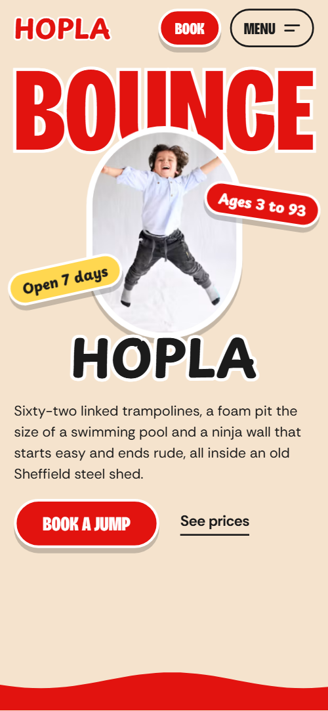

# Free HTML trampoline park website template with GSAP scroll animations

Trampoline park website template: a one-page site for an indoor venue that sells sessions, passes and birthday parties, with a zone list, a timetable, a party route, a café, a league table and a booking request form. The look is cream, red and yellow with wavy section edges and big condensed type. It is one HTML file with an AGENTS.md, so an AI agent can adapt it to your park.

[](LICENSE)  

**[Live demo](https://8bsite.github.io/trampoline-park-website-template/)** · **[Use this template](https://github.com/new?template_name=trampoline-park-website-template&template_owner=8bsite)** · **[Download ZIP](https://github.com/8bsite/trampoline-park-website-template/archive/refs/heads/main.zip)** · **[Template page on 8b.com](https://8b.com/templates/hopla/)**

<a href="https://8bsite.github.io/trampoline-park-website-template/"></a> <a href="https://8bsite.github.io/trampoline-park-website-template/"></a>

<p align="center"><a href="https://8bsite.github.io/trampoline-park-website-template/"></a><br><sub>Scroll animation</sub></p>

## Use it with Claude Code, Cursor or Codex

Download the four files into your project folder (`curl.exe` in Windows PowerShell):

```bash
curl -LO https://raw.githubusercontent.com/8bsite/trampoline-park-website-template/main/index.html
curl -LO https://raw.githubusercontent.com/8bsite/trampoline-park-website-template/main/AGENTS.md
curl -LO https://raw.githubusercontent.com/8bsite/trampoline-park-website-template/main/LICENSE
curl -LO https://raw.githubusercontent.com/8bsite/trampoline-park-website-template/main/CREDITS.md
```

Then fill in the angle brackets and give your agent this prompt:

```text
Read AGENTS.md, then edit index.html. Turn this template into the site for <my venue: the kind of park, city and address, the zones and their age limits, session names with days and times, pass prices, the party offer, the café menu, safety rules and waiver process, opening hours, how guests book>. Replace first the venue name, the zones, the sessions and the passes. Keep the section ids, the classes AGENTS.md lists, a --len number matching the headline word and the footer wordmark, and a distinct data-week number on every league row. Ask me for any missing fact and never invent prices, hours, addresses, safety rules, licences, reviews or contacts.
```

For vibe coding with Claude Code, Cursor or Codex, start with the facts only the venue can supply: name, address, opening hours, session times with age limits, pass prices, the party offer, the café menu and the safety rules. The demo's rules, waiver wording, lockers, parking and league times are all invented, so the agent must ask for the real ones. Keep the section ids and the classes AGENTS.md lists, and give each league row its own data-week number, its place in the previous order. The opening fan is built for three cards, in both its script and its CSS, and the timetable's colour run reads the --color variables by name, so change their values, not their names.

No agent? Click **[Use this template](https://github.com/new?template_name=trampoline-park-website-template&template_owner=8bsite)**, edit `index.html` on GitHub and turn on **Settings > Pages**.

## Sections and motion

- **Navigation**: fixed top bar: wordmark, Book button, Menu button opening a full-screen link overlay with contacts.
- **Bounce at Hopla, the trampoline park in Sheffield**: first screen: one giant word with a photo of a jumper in front, wordmark, two stickers, two short texts; then a red panel with heading, button and three tilted photos. Smooth scrolling throughout; wavy edges wobble and stickers slap on page-wide. As the red panel rises over the held first screen, the jumper lands on its edge, which sags and flings them off spinning.
- **One roof, six ways off the ground**: list of six activity zones in a zig-zag: big name, one line, age sticker, round photo (demo: trampoline zones). Tied to scroll, each round photo hops along an arc from the zone above and squashes as it lands.
- **The best bit is the middle**: full-width photo with a two-line statement held on screen while you scroll. The photo stays pinned and zooms out while the two heading lines rise at different speeds, tied to scroll.
- **One shed, five crowds**: timetable of five sessions as tickets: time, name, text, ages, photo (ground turns from morning yellow to night). As you scroll the timetable, the ground shifts from morning yellow through amber and red to night black, and the Glow Night ticket lights up.
- **Birthday parties, sorted**: birthday parties: heading, text, price line, button, and a five-step route with numbered tilted photos. Tied to scroll, a red ball hops along the dashed route from photo to photo, drawing a trail; each photo bumps as it lands.
- **The Landing**: on-site café: wide photo, round coffee photo, sticker, text, short price list.
- **Ninja Wall League**: ranking table of six results on a dark field, with heading, text, entry link and photo (demo: ninja wall times). Rows start in last Sunday's order and slide into this week's ranking as you scroll the table into view.
- **House rules, short version**: red wall of five tilted rule stickers and one photo (house rules).
- **Pick a pass**: five ticket-shaped passes with name, price and one line, plus two buttons. On screens wider than 700 px the five passes start fanned in a stack like a hand of cards and deal out into place as you scroll.
- **Asked a lot**: questions and answers (native &lt;details&gt;) next to a heading and a phone line. A big red question mark hops down the list from question to question as you scroll, squashing on each.
- **Come and jump**: address, opening hours, phone, email, directions and a booking request form (placeholders).
- **Footer**: links, address and phone, copyright with the Design: 8B credit, a giant outlined HOPLA wordmark with three round photos. The giant outlined wordmark drops in letter by letter, squashing on landing, while three round photos bounce into place.

## Design

 cream page background  
 red headings, buttons and red bands  
 text and the dark league band  
 yellow stickers and yellow bands  
 amber party route and timetable shade  
 white outlines on headings, photo frames, ticket cards and rule stickers

**Bricolage Grotesque**: headings, buttons and pass prices: condensed, extra bold, uppercase; the opening word, the zones heading and the footer wordmark are red with a white outline. **Playpen Sans**: wordmark and sticker pills: rounded and hand-drawn. **Rethink Sans**: body text, session times and labels (Google Fonts). Each band opens with a wavy edge like a slack trampoline bed and switches colour: cream, red, yellow, black. Headings are huge and several carry a white outline. Photos sit in round discs or tilted white frames, sessions and passes are cut like tickets with dashed tear lines, and pill stickers sit at an angle.

## Questions

**Does the booking form send requests?**  
No. The Ask for a slot form checks the name, email, date and number of jumpers, shows a thank-you line and clears itself, but sends nothing. Connect Formspree or Netlify Forms, or remove the form together with its script and keep the email link. AGENTS.md has the steps. Also edit the promise to reply within the hour.

**Is this trampoline park template only for trampoline parks?**  
No. The zone list, session tickets, pass cards and party route also suit a soft play centre, a ninja or climbing park or any kids' party venue. Rename the zones and sessions, change the age stickers and delete the league if you run no competitions. AGENTS.md lists what to remove with a section.

**How do I change the session times and prices?**  
Edit the plain text in index.html. Each session ticket holds days and times, a name, one line and an age group, and each pass card a name, a price and a line. The booking form has its own session list, the contact section its own opening hours, and the first screen an Open 7 days sticker, so check all three.

## Is it the right base?

Choose this template when families book time on equipment: a bounce centre, an indoor play centre, a ninja or climbing park, a venue that lives on birthday parties. It fits less well when the pitch is one dated event with a lineup and ticket tiers, where the [festival](https://8b.com/templates/ondo/) template has the right sections, or when the business is a coaching gym built around memberships and a weekly class schedule. The honest weak spot is booking. The page has request buttons and a form, but no live availability, payment or waiver tool, so a park with timed capacity needs a booking service behind the Book buttons.

## Before you publish

- Replace what is marked `data-8b-placeholder` (social preview image, favicon, phone, email, form) and the invented demo facts; [AGENTS.md](AGENTS.md) lists them.
- The form sends nothing yet: connect it to Formspree or Netlify Forms, or remove it.

## Tech

GSAP 3.13.0, ScrollTrigger, SplitText, MotionPathPlugin, Lenis 1.3.27 from jsDelivr, 126 KB, no build step. Chrome and Edge 111+, Safari 16.2+, Firefox 113+ (it uses color-mix(), cascade layers, small/dynamic viewport units). With "reduce motion" on, the page is complete and still.

## License

MIT, see [LICENSE](LICENSE). Photos, fonts and libraries keep their own licences: [CREDITS.md](CREDITS.md). More free templates: [8b.com/templates](https://8b.com/templates/) · [github.com/8bsite](https://github.com/8bsite).
